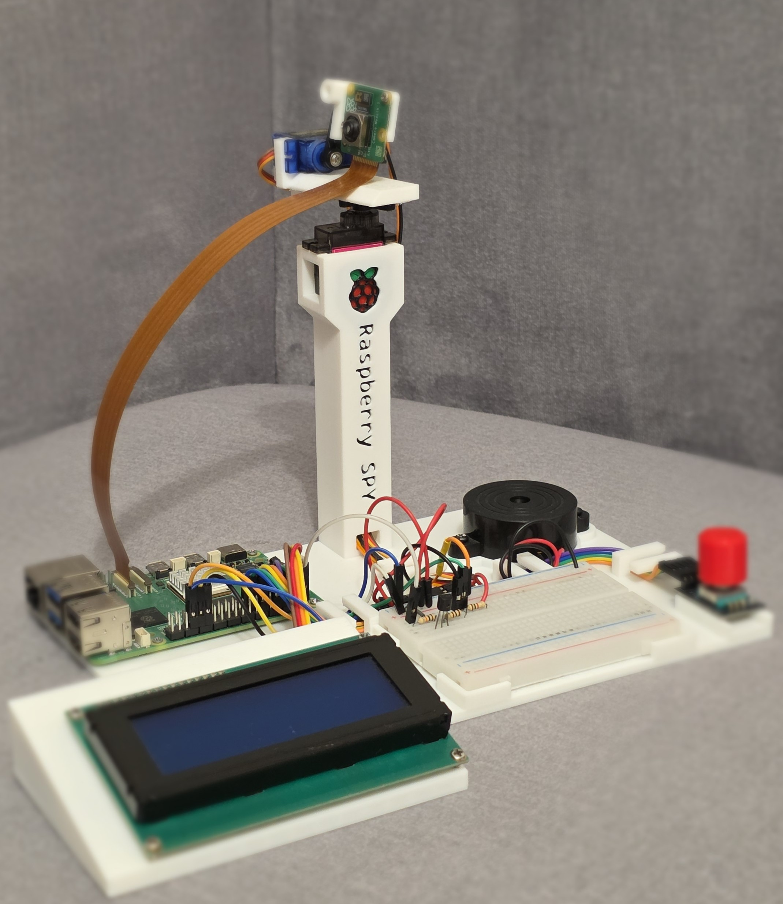
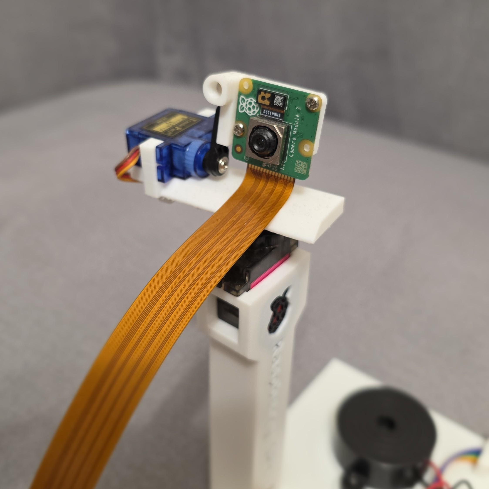
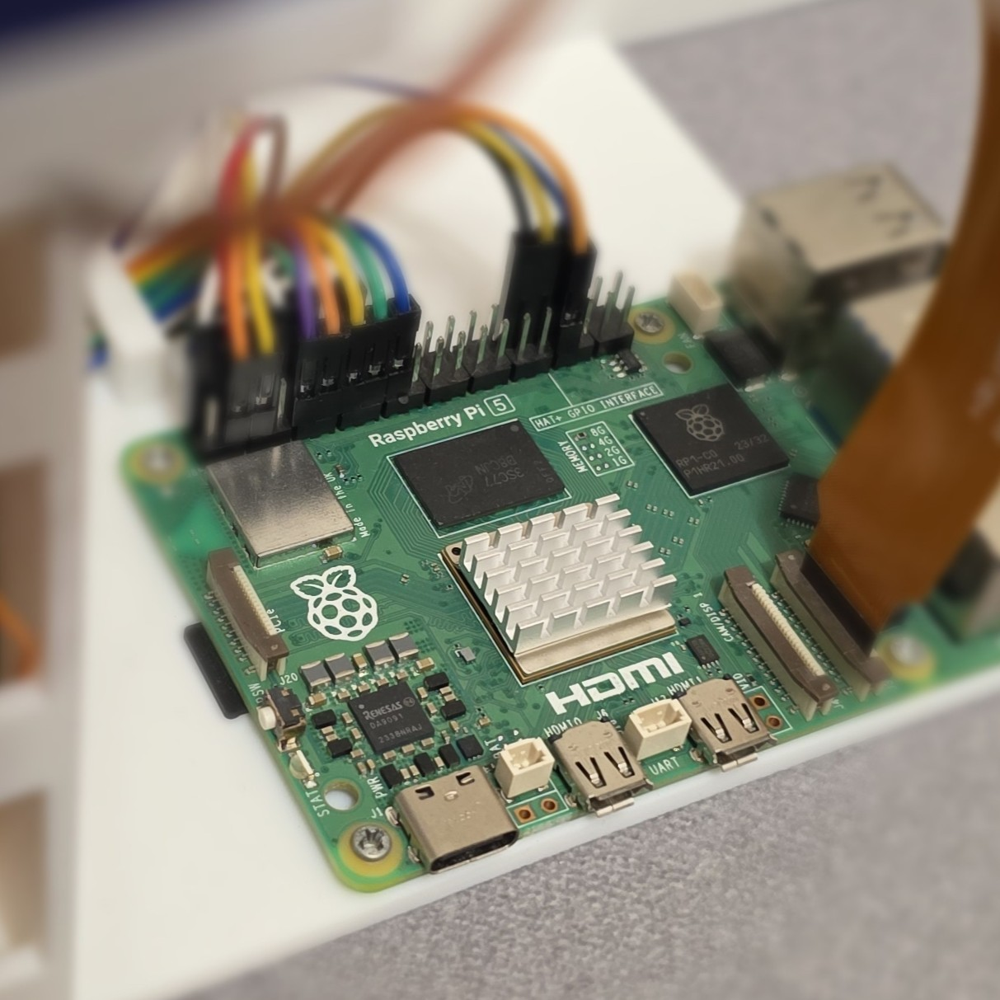
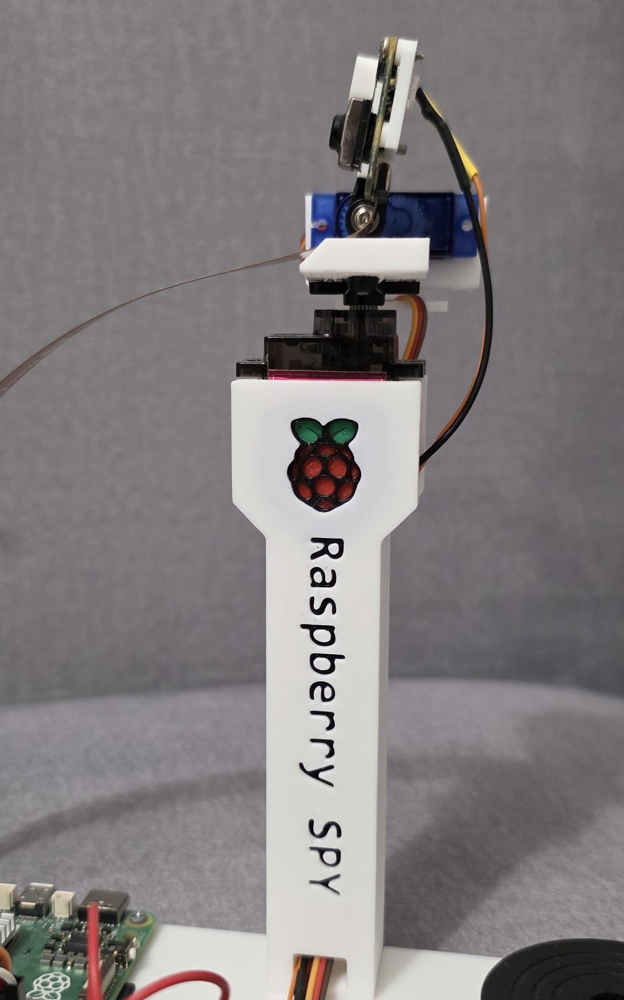
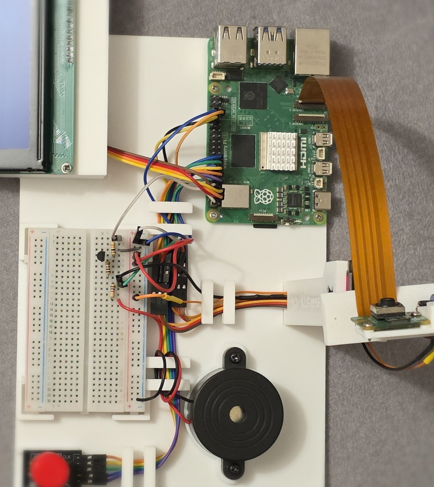

# The Raspberry SPY :eyes:

Hello! Welcome to my repository containing the Raspberry SPY app backend - developed since I obtained my engineering degree in 2024. It was intended to work as a home monitoring system, but I added some other extra features

#### Current features :on:

- live camera stream (HLS via MediaMTX's native Raspberry Pi camera source, started on demand)
- stream settings (resolution, frame rate, bitrate, exposure, white balance, focus) changeable at runtime from the UI
- camera viewing direction control
- adjustable camera backlight
- "local" interface built with 20x4 LCD display and rotary encoder
- programmable alarm clock built with a buzzer and 7 built-in melodies
- Cloudflare Tunnel exposing the API and stream at https://api.filipwisniewski.pl. Website (GitHub Pages) available at https://filipwisniewski.pl/

Page unavailable? Oops, I must have switched off my raspberry...

#### Components used

:computer: Raspberry Pi 5 module - 8GB RAM version

:camera: 12MPx Raspberry Pi Camera HD v3

:robot: SG90 and MG-90S micro servos

:symbols: 4x20 LCD display

:raised_back_of_hand: Rotary encoder

:speaker: Active buzzer

A custom-made 3D printed frame with a tall camera stand. See it in [Makerworld](https://makerworld.com/pl/models/2886103-the-raspberry-spy#profileId-3223978)

#### Software

:cd: Raspberry Pi OS

:snake: Python + FastAPI. As a Java developer I keep struggling with this language, but I find it really educational. [Frontend](https://github.com/Filip1159/The-Raspberry-SPY-frontend) written in TypeScript + Angular

:traffic_light: `gpiozero` python library for Raspberry Pi that handles raw GPIO communication

:video_camera: [MediaMTX](https://github.com/bluenviron/mediamtx) server that provides live camera stream via the HLS protocol

:satellite: [Nginx](https://nginx.org/) server configured as a reverse proxy

:earth_africa: [Cloudflare Tunnel](https://developers.cloudflare.com/cloudflare-one/connections/connect-networks/) to expose the service publicly

#### Running without a Raspberry :computer:

The hardware (servos, LCD, buzzer, BLE sensor, ...) is simulated, so the backend runs on any machine:

```bash
scripts/setup_venv.sh --dev && source .venv/bin/activate   # python3 -m venv .venv + pip install -r requirements-dev.txt
python scripts/dev_setup.py   # keys, demo/demo user, alarms
python main.py --fake
```

On the Raspberry use `scripts/setup_venv.sh` (installs `requirements-raspberry.txt` into `.venv`) and `python main.py`; for production run it as a systemd service (`scripts/install_service.sh`, updates with `scripts/deploy.sh`, which the `deploy` job of the CI pipeline runs automatically on every push to `master` through a self-hosted runner on the Pi; setup and troubleshooting in `configs/CONFIGS.MD`).

#### Gallery

<table>
  <tr>
    <td width="50%"><br /><sub>The whole device</sub></td>
    <td width="50%"><br /><sub>The camera</sub></td>
  </tr>
  <tr>
    <td width="50%"><br /><sub>Raspberry Pi 5</sub></td>
    <td width="50%"><br /><sub>Raspberry Pi 5, labelled</sub></td>
  </tr>
  <tr>
    <td width="50%"><br /><sub>Top view</sub></td>
    <td width="50%"></td>
  </tr>
</table>
